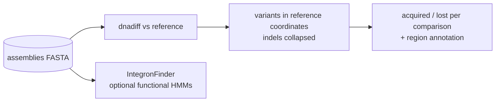

# SNIGRON

**SNPs, indels and integrons in bacterial genome assemblies — a Nextflow pipeline.**

[](https://github.com/mario-garcia-calleja/snigron/actions/workflows/ci.yml)


SNIGRON finds the variants a strain acquired or lost relative to its control, reports which ones fall
in genes of interest (and their upstream regions), and screens every assembly for integrons. It was
developed for my Bachelor's thesis on *Escherichia coli* strains with different levels of quinolone
resistance, and works with any bacterial genome given its reference FASTA and a BED file of regions.

Companion pipeline: [METION](https://github.com/mario-garcia-calleja/metion) (DNA methylation from Nanopore reads).



## Background

Experimental evolution and clinical isolates often come in pairs: a susceptible parent and a
resistant derivative. The question is which mutations separate them and whether they hit known
resistance genes or their promoters. SNIGRON answers it from genome assemblies (for example from
hybrid Nanopore + Illumina assembly) and screens each strain for integrons, the genetic platforms
that capture and express antibiotic resistance gene cassettes.

## How comparisons work

Every assembly is aligned to the same reference with MUMmer `dnadiff`, so all variants share
reference coordinates and can be annotated with one BED file. For each control/treated pair:

- **acquired**: present in the treated strain and absent from its control;
- **lost**: present in the control only.

SNPs are matched on their alleles. Indels, which `dnadiff` reports one base per row, are collapsed
into single events and matched on position and length, because the same insertion can be written
with rotated bases in repetitive sequence.

## Quick start

```bash
git clone https://github.com/mario-garcia-calleja/snigron.git
nextflow run snigron/main.nf -profile test,conda          # synthetic data, ~2 min
```

```bash
nextflow run snigron/main.nf -profile conda \
    --samplesheet samplesheet.csv \
    --comparisons comparisons.csv \
    --reference GCA_000005845.2_ASM584v2_genomic.fna \
    --regions snigron/assets/ecoli_k12_quinolone_resistance.bed \
    --func_hmm_dir databases/resfams          # optional
```

## Inputs

```csv
sample,fasta
control_A,assemblies/control_A.fasta
resistant_A,assemblies/resistant_A.fasta
```

```csv
comparison,control,treated
pair_A,control_A,resistant_A
```

Relative paths are resolved against the samplesheet's folder. **Regions**: any BED file whose
chromosome names match the reference; `assets/ecoli_k12_quinolone_resistance.bed` lists 21
*E. coli* K-12 MG1655 genes involved in quinolone and multidrug resistance.

## Parameters

| Parameter | Default | Description |
|---|---|---|
| `--func_hmm_dir` | | Folder with pressed HMMs (e.g. Resfams, `scripts/download_resfams.sh`) for IntegronFinder functional annotation |
| `--skip_integrons` | `false` | Skip IntegronFinder |
| `--flank` | `200` | bp upstream of each region also reported (both sides when strand is `.`) |
| `--max_cpus` / `--max_memory` | `16` / `64.GB` | Upper limits for any single task |

## Example

The bundled test (`-profile test`) plants two SNPs and a 12 bp deletion in a synthetic treated
strain. `snigron_comparisons.tsv` recovers exactly those changes:

| comparison | change | ref_pos | ref_base | alt_base | type | length | region |
|---|---|---|---|---|---|---|---|
| pair1 | acquired | 3001 | T | A | snp | 1 | gene_A |
| pair1 | acquired | 10001 | T | G | snp | 1 | gene_B |
| pair1 | acquired | 15501 | GAATTTTCCATT | . | deletion | 12 | gene_C |

## Outputs

```
results/
├── dnadiff/     <sample>.snps / .report / .1coords / .delta
├── integrons/   Results_Integron_Finder_<sample>/
├── report/
│   ├── snigron_variants_vs_reference.tsv   every variant of every sample, annotated
│   ├── snigron_comparisons.tsv             acquired / lost variants per comparison
│   ├── snigron_summary.tsv                 SNPs, insertions, deletions per sample
│   └── snigron_report.xlsx                 summaries and variants in regions
└── pipeline_info/
```

## Installation

[Nextflow](https://www.nextflow.io/) ≥ 24.04 and Conda, Mamba or Micromamba. Each process declares its
own Bioconda environment (`MUMmer 3.23`, `IntegronFinder 2.0.6`). Profiles: `conda`, `mamba`,
`micromamba`, `slurm`, `test`.

## Testing

```bash
conda env create -f environment.yml && conda activate snigron
pytest tests/python
python tests/make_test_data.py
nextflow run main.nf -profile test -stub-run
```

GitHub Actions runs the unit tests and a stub run on every push. Test data are simulated.

## Limitations

- Variants are called from whole-genome alignments of assemblies; assembly errors propagate into
  the calls. Read-level variant calling is a better choice when assembly quality is uncertain.
- Large structural rearrangements are reported by `dnadiff` (`.report`) but not summarised.

## Author

**Mario García Calleja** — [LinkedIn](https://www.linkedin.com/in/mariogarciacalleja/)

Acknowledgements: Dra. Marta Hernández Pérez and Dr. José María Eiros (supervision) and
Dr. Lucas Domínguez Rodríguez (VISAVET, Universidad Complutense de Madrid).

## License

[MIT](LICENSE)
